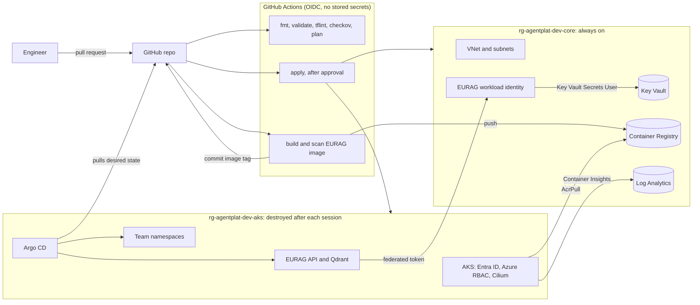

# Azure Agent Platform

A small internal platform on Azure where a team can deploy an AI agent to AKS. All infrastructure is Terraform, deployments go through CI/CD and GitOps, and each team's access is driven by one YAML file.

The workload is [EURAG](https://github.com/kashastic/eu-rag), my citation-first RAG over EU law: a FastAPI service with Qdrant, local ONNX embeddings and reranking, and Claude for answers.

## What it covers

| Area | What is in this repo |
| --- | --- |
| Infrastructure as Code | Terraform in five small stacks with separate remote state, built from six reusable modules |
| Identity | No passwords anywhere. Entra ID for people, OIDC federation for GitHub Actions, managed identities for the cluster, workload identity for the app |
| Kubernetes | AKS with Entra ID and Azure RBAC, local accounts disabled, Azure CNI Overlay with Cilium network policies |
| CI/CD | Pull request checks (fmt, validate, tflint, checkov, plan), gated apply, image build and scan |
| GitOps | Argo CD deploys from Git. CI never touches the cluster; it only commits an image tag |
| Self-service access | `platform/teams.yaml` becomes Entra ID groups, namespace-scoped Azure RBAC, and namespaces with quotas and network policies |
| Guardrails | Azure Policy (allowed regions, required tags), a subscription budget, a log ingestion cap |
| Observability | Container Insights on a cost preset, control plane audit logs, alerts on node pressure and container restarts |

## Architecture



## How a change reaches the cluster

**Infrastructure.** A pull request runs `terraform fmt`, `validate`, `tflint` and `checkov` on every stack, and a real `plan` of the foundation stack with a read-only identity. After merge, a manual run of the `terraform` workflow applies one stack, but only once a reviewer approves the `dev` environment. The apply identity only trusts tokens issued for that environment.

**Application.** The `build-eurag` workflow checks out EURAG at a pinned commit, builds a `linux/amd64` image, scans it, and pushes it to the registry tagged with the EURAG commit. It then commits the new tag to `apps/eurag/chart/values-dev.yaml`. Argo CD sees the commit and rolls the deployment. Rolling back is a `git revert`.

**A new team.** Add an entry to [`platform/teams.yaml`](platform/teams.yaml) in a pull request. Terraform creates the team's Entra ID group and grants it a role on its namespace only; Argo CD creates the namespace with a resource quota, default limits and a default-deny network policy. Nobody clicks anything in the portal, and the history of who got access is the Git log.

## Repository layout

```
infra/
  bootstrap/            remote state storage and the three GitHub identities (local state, run once)
  modules/              network, key-vault, container-registry, log-analytics, aks, guardrails
  envs/dev/
    common.tfvars       shared by every stack
    foundation/         VNet, Key Vault, registry, Log Analytics, EURAG identity, policy, budget
    access/             Entra ID group per team (from platform/teams.yaml)
    aks/                cluster, team role assignments, workload identity federation, alerts
    platform/           Argo CD and the applications it manages
  charts/argocd-apps/   the Argo CD Applications, with values handed over from Terraform
apps/eurag/chart/       EURAG API, Qdrant StatefulSet, Key Vault secrets, network policies
platform/
  teams.yaml            who can do what, in one file
  team-namespaces/      chart that turns teams.yaml into namespaces
.github/workflows/      terraform, build-eurag, kubernetes-manifests
docs/                   RUNBOOK.md (deploy it), DESIGN.md (why it is built this way)
```

## Stacks

| Stack | Creates | Lifetime |
| --- | --- | --- |
| `bootstrap` | State storage account, GitHub plan, apply and build identities | Once |
| `foundation` | Core resource group, VNet, Key Vault, registry, Log Analytics, EURAG identity, policies, budget | Always on (a few euros a month) |
| `access` | Entra ID groups from `teams.yaml` | Always on (free) |
| `aks` | Cluster, team RBAC, federated credential, alerts | Destroyed after each session |
| `platform` | Argo CD and its Applications | With the cluster |

Each stack has its own state file, so a mistake in one has a small blast radius, and the expensive cluster can be destroyed without touching the rest. Stacks find each other's resources through a naming convention and data sources, not hard-coded IDs.

## Run it

[docs/RUNBOOK.md](docs/RUNBOOK.md) walks through it from an empty subscription: bootstrap, foundation, image build, access, AKS, platform, then teardown. In short:

```bash
make plan apply STACK=foundation
make plan apply STACK=access
make plan apply STACK=aks
make kubeconfig
make plan apply STACK=platform
kubectl -n eurag port-forward svc/eurag 8000:8000   # http://localhost:8000
make down                                           # destroy platform and aks
```

## Design decisions

The reasoning behind each choice, with the trade-offs, is in [docs/DESIGN.md](docs/DESIGN.md). The short version:

| Decision | Why |
| --- | --- |
| Small stacks with separate state | Small blast radius, fast plans, and the cluster can be destroyed alone |
| Three GitHub identities (plan, apply, build) | A pull request can read but never change anything; only an approved environment job can apply |
| Entra ID and Azure RBAC on AKS, local accounts off | One identity system, every permission is an auditable role assignment |
| Workload identity and the Key Vault CSI driver | The pod reaches Key Vault with a federated token; no key exists to leak |
| Terraform bootstraps Argo CD, then hands over | Terraform owns Azure; Git owns what runs in the cluster |
| One `teams.yaml`, two consumers | Terraform and Argo CD can't disagree about who a team is |
| Policies with the deny effect | A wrong region or a missing tag fails at deploy time instead of showing up in a report |

## Cost

On an Azure for Students subscription, the foundation costs a few euros a month (mostly the Basic registry). The cluster is one `Standard_B2ms` node on the free AKS tier, about 0.10 EUR an hour while it runs, and it is destroyed after each session. Log ingestion is capped at 0.5 GB a day and a subscription budget emails at 50% of actual and 100% of forecast spend.

## Known limits and next steps

- **Private endpoints.** Key Vault and the registry still have public endpoints (RBAC-only). A subnet is already reserved for private endpoints and private DNS.
- **CI identity scope.** The apply identity has Contributor and RBAC Administrator on the subscription. In a shared subscription it would be scoped to the platform resource groups, with a condition limiting which roles it can assign.
- **Entra ID from CI.** Applying the `access` and `aks` stacks from CI needs Microsoft Graph permissions (`Group.ReadWrite.All`, `User.Read.All`) on the apply identity. Until a tenant admin grants them, those two stacks are applied locally.
- **One node, no zones.** Production would split system and user node pools, spread across availability zones, and use the Standard tier with its SLA.
- **EURAG scales vertically for now.** Its document registry is a per-instance SQLite file, so the HPA is off until the registry moves to Postgres.
- **Databricks.** A Databricks workspace with Unity Catalog, onboarded through the same `teams.yaml`, is the natural next stack.

---

Built by Akash Acharya. MIT licensed.
